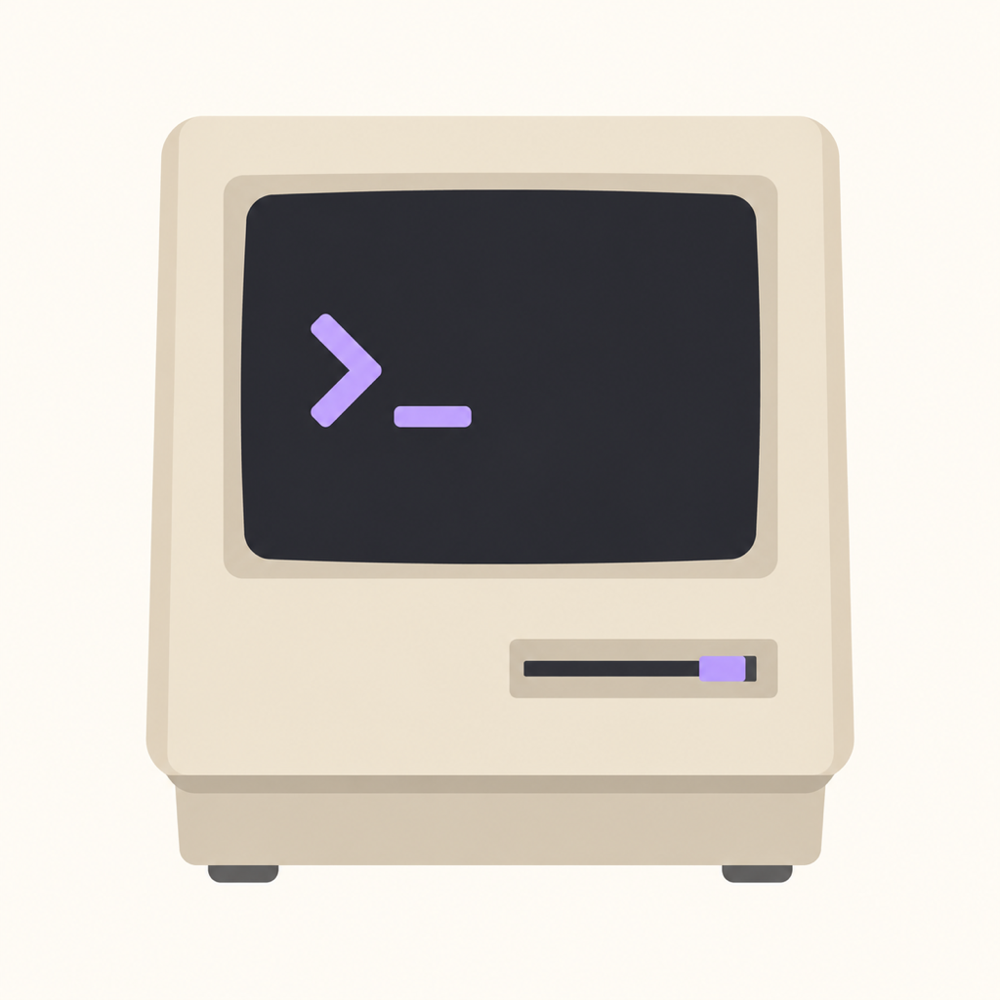

<h1 align="center">Zcode Connect · iOS 16 巨魔版</h1>

<strong>让 iPhone 在 iOS 16 ~ 26 上继续使用 ZCode 手机客户端，TrollStore 永久免签安装</strong>

  
  
  
  

> 电脑上的 AI 任务还在跑，你却要出门了——[Zcode Connect](https://github.com/PacoZhou1/zcode-connect) 解决的就是这件事。但它要求 **iOS 26**，而巨魔（TrollStore）最高只支持到 iOS 17.0，两头堵。
>
> 本仓库把最低系统要求降到 **iOS 16.0**，让 iOS 16 ~ 26 的 iPhone 都能用上它，并且**不需要 Mac**：推送代码后 GitHub Actions 云端自动编译出免签 IPA。

---

## ✨ 相比上游新增

| 功能 | 说明 |
|---|---|
| 📱 **iOS 16 全量适配** | 部署目标 26.0 → 16.0：`@Observable` → `ObservableObject`、Liquid Glass 兼容层（iOS 26+ 真实玻璃，低版本 Material 近似）、iOS 17/18 专属 API 全部降级 |
| ✨ **优化输入** | 对齐桌面端同名功能：composer ✨ 菜单可开关「发送前自动润色」，支持配置模型（openai / anthropic 双协议、Base URL、API Key、超时、测试连接），失败自动回退原文 |
| 📦 **IPA 安装器** | 粘贴安装包直链（.ipa / .tipa，局域网 HTTP 也可）→ 一键唤起 TrollStore 从网址直接安装；或带进度条下载后走分享面板；带历史记录 |
| 🔁 **云端构建流水线** | `.github/workflows/build-ipa.yml`：macOS runner + Xcode 26 + xcodegen，push 即出未签名 IPA，Fork 后开箱即用 |

连接、会话管理、子智能体、任务/计划模式等核心能力与上游一致，此处不再重复。

## 📥 下载安装（无需 Mac、无需开发者账号）

**[⬇️ 最新 IPA（v1.2）](https://github.com/aksjask/zcode-connect-ios16/releases/download/v1.2-ios16/ZCodeMobile-ios16-v1.2.ipa)** · [全部版本](https://github.com/aksjask/zcode-connect-ios16/releases)

1. iPhone 需已安装 [TrollStore](https://github.com/opa334/TrollStore)（iOS 14.0–16.6.1、16.7 RC、17.0 可装巨魔）
2. 手机浏览器打开上面的下载链接 → 下载 IPA
3. 打开 **TrollStore → Apps → 右上角 ＋** → 选中 IPA → 安装

巨魔安装**不校验签名、7 天不过期、不需要开发者账号**。

> iOS 17.0.1+ / 18 / 26 的设备装不了巨魔：iOS 26 直接用 [App Store 官方版](https://apps.apple.com/app/id6820455082)；18/26 想侧载可看 SideStore / LiveContainer。

## 🚀 快速上手

1. **电脑端**：ZCode 桌面版 → 左下角手机图标 → 开启远程控制
2. **手机端**：扫码或粘贴连接链接 → 选择项目 → 开始
3. **优化输入**：输入框工具栏 ✨ → 模型配置 → 填入你的 API（和桌面端 `~\.optimize-input.json` 同构，保存在手机本机）
4. **装别的 App**：首页 ⋯ 菜单 → IPA 安装器 → 粘贴任意 .ipa/.tipa 直链

## ⚠️ 已知问题：新版桌面扫码无法连接

**桌面版 ≥ 3.16.x 的远程控制二维码格式变了**：不再内嵌配对凭据 `hash`，而本客户端（含官方 Web 配对页）需要 `hash` + `t` 参数完成 HMAC 挑战认证。表现为扫码/粘贴均提示无法识别。

- 已确认的排查细节：[上游 issue #1](https://github.com/PacoZhou1/zcode-connect/issues/1)
- 临时方案：等待上游适配；或使用桌面版 **Bot Channel**（微信/飞书/Telegram）作为手机侧入口

## 🔨 从源码构建

仓库自带 GitHub Actions 云构建（macOS + Xcode 26），**Fork 后 push 即可出包**，无需本地 Mac。本地构建见 [BUILD_IOS16.md](BUILD_IOS16.md)。

兼容层实现要点

- `Design/Theme.swift` 尾部：iOS 16 兼容层（`compatGlassEffect` / `compatChange` / `compatScrollAnchor` / `CompatUnavailableView` / 按钮样式）
- 所有 `#available` 分支保持与原调用完全一致的形式，iOS 26+ 行为不变
- `Core/OptimizeInput.swift` + `Features/OptimizeInputConfigView.swift`：优化输入
- `Features/IPAInstallerView.swift`：IPA 安装器

## 🙏 致谢与声明

- 核心客户端基于 [PacoZhou1/zcode-connect](https://github.com/PacoZhou1/zcode-connect)（MIT），感谢原作者的优秀作品；本仓库仅做系统版本适配与功能增强
- 上游原始说明见 [docs/UPSTREAM_README.md](docs/UPSTREAM_README.md)
- 本项目为**非官方**第三方客户端，与 Z.ai 无关；连接凭据请妥善保管，勿将配对二维码/链接分享给他人
- 仅供个人学习与自用，请遵守所在地区的相关法规
